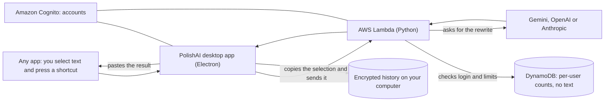

# PolishAI

**Select text in any app, press a shortcut, and it's rewritten in place.**

PolishAI is a Mac app that lives in your menu bar. Highlight a rough sentence in Mail, Slack, Notes, a web page, anywhere, press a shortcut, and it's replaced with a cleaner version. There are two styles: a casual **message** and a polished **email**.

<p align="center">
  
</p>
<p align="center"><sub>Sample data.</sub></p>

## What you get

- **Rewrites in any app.** A global shortcut copies your selection, rewrites it, pastes it back, and puts your clipboard back the way it was. It never pastes into the wrong app if you switch windows mid-rewrite.
- **Your own shortcuts.** Defaults are Control+Q (message) and Control+Y (email). Click one in Settings and press the keys you want. Combinations that would break your Mac, like Cmd+C, are refused.
- **An insights home screen.** Rewrites, words polished, estimated time saved, a 20-week streak calendar, a message/email split, your top apps, and a 7-day chart. Click any day to see what you did.
- **History you can read.** The full original and rewritten text of every rewrite, stored only on your computer and encrypted.
- **Bring your own AI key,** from Gemini, OpenAI or Anthropic, or use the free shared Gemini key (limited per person per day).
- **Real accounts.** Sign up, stay logged in, reset or change your password, and delete your account and all of its data.

<table>
  <tr>
    <td></td>
    <td></td>
  </tr>
  <tr>
    <td align="center"><sub>History: what you wrote and what PolishAI wrote</sub></td>
    <td align="center"><sub>Settings: pick Gemini, OpenAI or Anthropic</sub></td>
  </tr>
</table>

## How it works



1. A small native Swift helper presses Copy and Paste for you in the app you're using (macOS asks you to allow this once under Accessibility).
2. The desktop app sends the text to a Python function on AWS Lambda with your login token.
3. The function verifies the token, applies the rate limits, calls the AI provider, and returns the rewrite. It records counts (words, format, app name) but **never stores your text**.
4. The full text goes into an encrypted History file on your own computer.

## Design decisions worth knowing

- **Your text isn't kept on the server.** Servers hold your account and simple counts. History lives only on the device, encrypted with a key kept in the macOS Keychain.
- **API keys are encrypted at rest** (AES-GCM, bound to the user's ID, so a stored key can't be moved to another account).
- **The desktop app is locked down.** The window has no access to the computer: all network calls, files and secrets live in a separate main process, and the page can only call a short list of named functions.
- **A surprise bill is hard to cause.** Gemini has no billing account, so Google can't charge anything. On AWS there are layered limits: a per-person and an everyone-combined daily cap, a per-minute limit, a daily sign-up limit, a database speed cap, and an automatic kill switch that stops the backend on a request flood or when the month's bill reaches $9.
- **Tested against the real thing.** Besides unit tests, end-to-end scripts drive the real app against the live backend with throwaway accounts, including a test that exercises the real macOS clipboard.

## Install (Mac)

Download the right `.dmg` for your Mac from the [Releases page](https://github.com/rahimrehann/polishai/releases) and follow **[INSTALL.md](INSTALL.md)**. It needs macOS 13 or newer. The app isn't signed by Apple yet, so macOS asks you to approve it once; the steps are in the guide.

## Run it from source

**Desktop app** (needs Node 22 and the Xcode command line tools for the Swift helper):

```bash
cd desktop-app
npm install
npm start          # builds the helper if needed, then opens the app
npm test           # unit tests
npm run dist       # builds the .dmg installers into desktop-app/dist
```

**Backend** (needs Python 3.13, and an AWS account if you want to deploy it):

```bash
cd backend
python3 -m venv .venv
.venv/bin/pip install -r requirements.txt
.venv/bin/python -m unittest discover -s tests     # unit tests
./deploy.sh                                        # packages and updates the Lambda function
```

For local scripts, put `GEMINI_API_KEY=...` in `backend/.env` (it is git-ignored).

## Testing

| What | How | Count |
|---|---|---|
| Backend unit tests | `cd backend && .venv/bin/python -m unittest discover -s tests` | 78 |
| Desktop app unit tests | `cd desktop-app && npm test` | 146 |
| Chrome extension tests | `cd extension && npm install && npm test` | 14 |
| Live backend check | `python3 backend/scripts/smoke_test.py` | 30+ checks |
| Real-app end-to-end | `cd e2e && npm install && node features.js` (see the other scripts there) | 160+ checks |
| Cost-safety check | `backend/.venv/bin/python backend/scripts/check_protections.py` | every guard |

The live and end-to-end checks create temporary Cognito test accounts and delete them again, so they need AWS access to the project's account.

## Project layout

```
desktop-app/   The Electron app: main process (src/), the page, the Swift key helper (native/), build config
backend/       Python on AWS Lambda: handler, AI providers, the sign-up limit, the kill switch, scripts and tests
e2e/           End-to-end tests that drive the real app against the live backend
extension/     The original Chrome extension (legacy, see below)
docs/          Screenshots
INSTALL.md     Install guide for people using the app
```

## Costs and limits

| | Limit |
|---|---|
| Free rewrites on the shared Gemini key | 20 per person per day, 450 per day for everyone |
| All rewrites together, any key | 3,000 a day |
| Rewrites per person | 12 a minute |
| New accounts | 100 a day |
| Backend shut-off | 2,000+ requests in 5 minutes, or the AWS bill reaching $9 in a month |

Everything currently runs inside free tiers. The usage report is `backend/scripts/admin_report.py` (counts only, never text).

## Known limits

- Mac only (macOS 13+). No Windows or Linux version.
- Not signed or notarized by Apple (that needs a paid developer account), so the first launch needs a one-time approval.
- No automatic updates: new versions are downloaded from the Releases page.
- Sign-up emails come from Cognito's built-in sender, which is capped at about 50 a day.
- The AWS setup was built by hand and isn't defined as code yet.

## The Chrome extension (legacy)

`extension/` is the first version of PolishAI: a floating button on web pages. It still works with the backend (and has tests that make sure an error never erases your text), but it isn't maintained. The desktop app replaces it and works in every app, not just the browser.

## Tech

Electron 44 (plain JavaScript, no framework or bundler) · Swift (a small CGEvent helper) · Python 3.13 on AWS Lambda · Amazon Cognito · DynamoDB · CloudWatch and SNS · Google Gemini, OpenAI and Anthropic APIs · electron-builder
