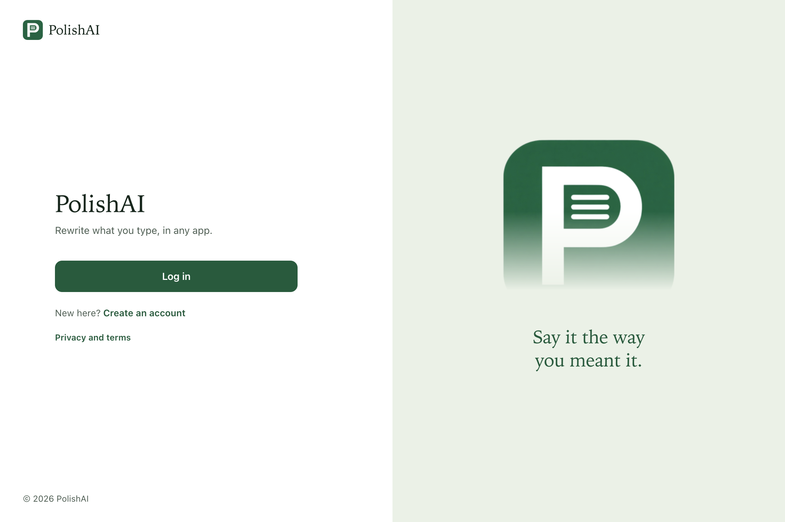
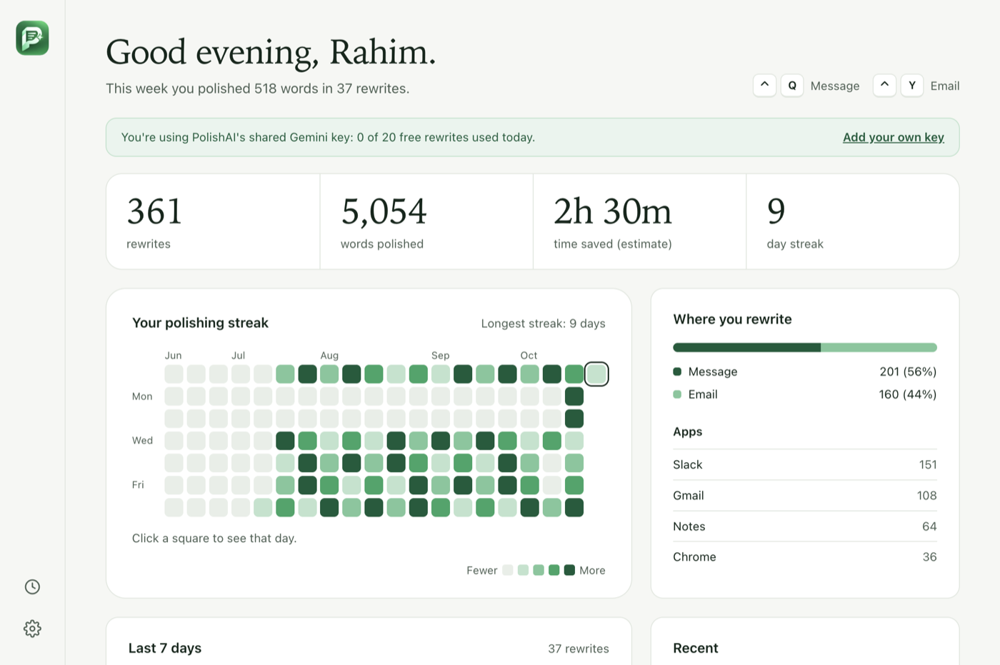
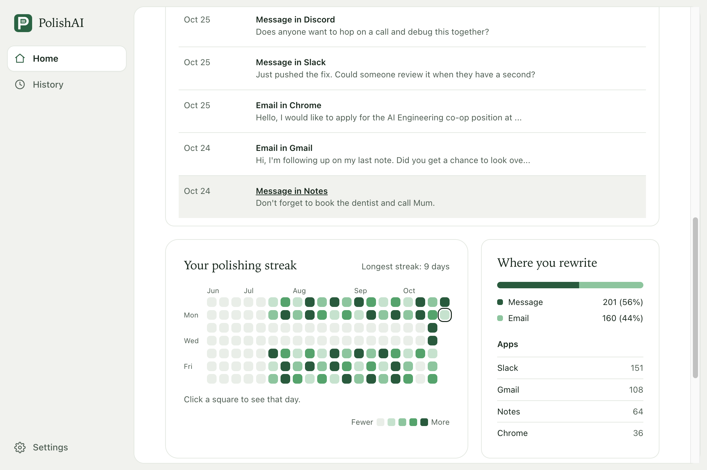
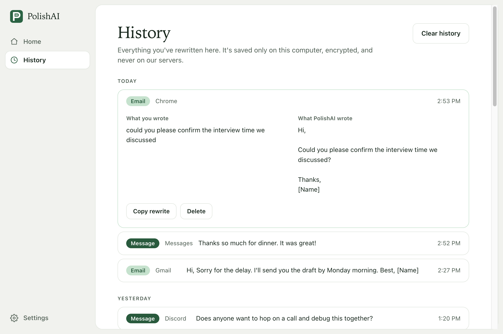
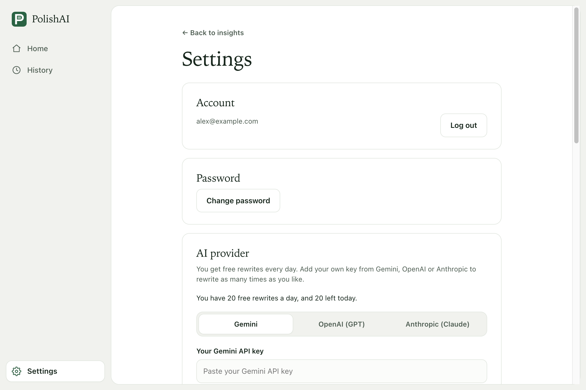
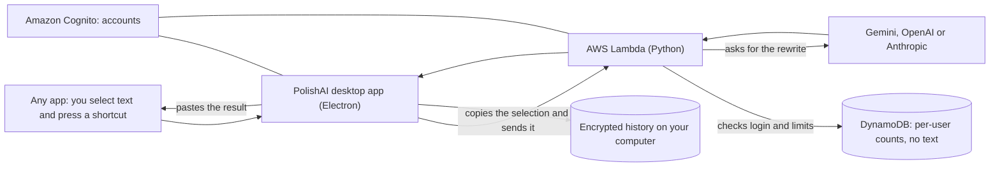

# PolishAI

**Highlight text in any Mac app, press a shortcut, and it's rewritten in place.**

**[Try and Download Now](https://trypolishai.vercel.app/)**

PolishAI lives in your menu bar. Select a rough sentence in Mail, Slack, Notes, a web page, anywhere, and press a shortcut. The text is replaced with a clearer version, and your clipboard is put back the way it was. There are two styles:

- **Message** (`Command + F`): reworded to sound natural, the way people actually talk in Slack or iMessage. No greeting or sign-off.
- **Email** (`Command + G`): reworded to sound clear and professional, then set out as a proper email with a greeting, short paragraphs and a sign-off.

<p align="center">
  
</p>

## What it looks like

| You write | Message | Email |
|---|---|---|
| `hey can u send me the report by friday thx` | Hey, can you send me that report by Friday? Thanks. | Hi,<br><br>Could you please send me the report by Friday?<br><br>Thanks,<br>[Name] |
| `yo i cant make the mtg tmrw something came up can we move it to thurs` | Hey, I can't make the meeting tomorrow because something came up. Can we move it to Thursday? | Hi,<br><br>I am unable to attend our meeting tomorrow due to an unexpected conflict. Would it be possible to reschedule for Thursday?<br><br>Best,<br>[Name] |

Both styles keep your meaning and details. They fix the wording; they don't invent anything.

## Your home screen

Rewrites, words polished, estimated time saved and your day streak, with your two shortcuts always in view.

<p align="center">
  
</p>

Scroll down for a 20-week streak calendar, the split between messages and emails, and your most-used apps. Click any day to see what you did.

<p align="center">
  
</p>
<p align="center"><sub>Screenshots use sample data.</sub></p>

## History you can read

The full original and the rewrite, side by side. History is saved only on your computer, encrypted, and never on a server.

<p align="center">
  
</p>

## Settings

Choose your own shortcuts, pick your AI provider, change your password, or delete your account and everything stored about it.

<p align="center">
  
</p>

- **Free to start:** 20 free rewrites a day.
- **Your own key:** add a key from Gemini, OpenAI or Anthropic to rewrite as much as you like, and switch back to the free rewrites any time.
- **Works everywhere:** the shortcuts work in any app, and keep working with the window closed.
- **Private:** your text isn't kept on the server, only simple counts such as words and which app.

## How it works



1. A small native Swift helper presses Copy and Paste for you in the app you're using. macOS asks you to allow this once, under Accessibility.
2. The desktop app sends the selected text and your login to a Python function on AWS Lambda.
3. The function checks your login and limits, asks the AI provider for the rewrite in the style you chose, and returns it. It records counts only and never stores your text.
4. The app pastes the rewrite over your selection, restores your clipboard, and saves the full text to your encrypted History on your own computer. It never pastes into the wrong app if you switch windows while it works.

## Project layout

```
desktop-app/   The Mac app (Electron): main process in src/, the page, the Swift key helper in native/, build config
backend/       Python on AWS Lambda: the handler, the AI providers, prompts, scripts and tests
website/       The one-page marketing site
e2e/           End-to-end tests and the screenshot script that drive the real app
extension/     The original Chrome extension (legacy, no longer maintained)
docs/images/   Screenshots used in this README
INSTALL.md     Install guide for people using the app
```
